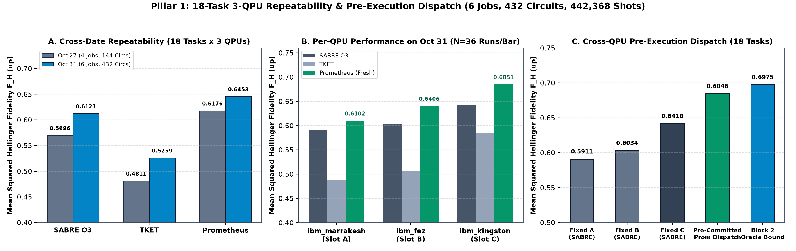
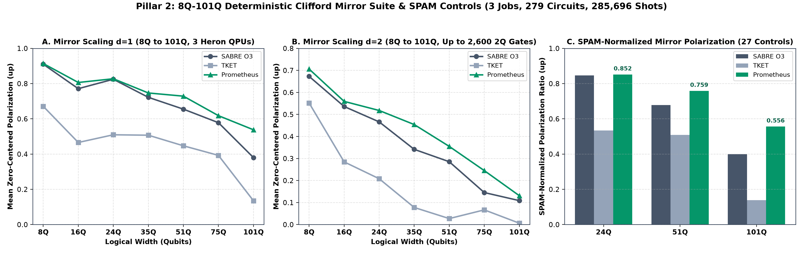
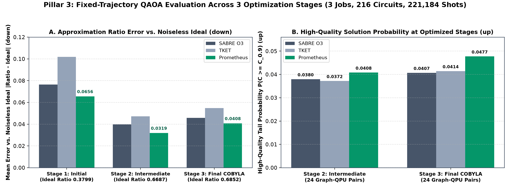
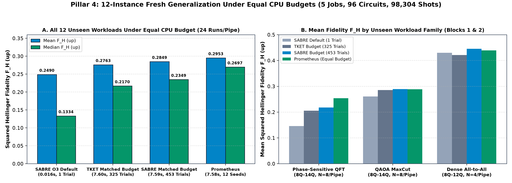

# Extended Multi-QPU IBM Heron Hardware Campaign Results (October 31, 2026)

Offline-auditable hardware dataset, pre-execution SHA-256 commitments, raw measurement histograms, and verification suite for the **4-Pillar Extended IBM Heron Validation Campaign** across all three operational 156-qubit IBM Heron processors (`ibm_marrakesh`, `ibm_fez`, and `ibm_kingston`).

**Total Verified Hardware Scope:** **17 sequential IBM Quantum batch jobs** | **1,023 compiled physical circuits** | **1,047,552 physical shots** | **326.00 s** verified QPU charge time (285.22 s active execution time, matching our pre-execution additive estimate of 331.02 s within 1.5%).

---

## 1. Executive Summary & Principal Comparative Benchmarks

### Key Empirical Takeaways
- **Pillar 1A - 18-Task 3-QPU Repeatability (6 Jobs, 432 Circuits, 442,368 Shots):** Across all 54 `(workload, QPU)` pairs (2 randomized ABBA blocks each), **Prometheus** ranked #1 in mean and median F_H, F_B, and TVD across both calibration dates (Oct 27 and Oct 31), improving mean F_H by **+5.42%** (0.6453 vs. 0.6121 Qiskit SABRE O3 and 0.5259 Quantinuum TKET) and reducing TVD by **-8.11%** (0.4081 vs. 0.4442) while cutting native 2Q gates by **-12.06%** (108.0 vs. 122.8) and compiled depth by **-14.19%** (189.8 vs. 221.2).
- **Pillar 1B - Pre-Committed Cross-QPU Dispatch (18 Tasks x 2 Blocks):** Pre-committed 3-QPU dispatch achieved **0.6846 *(mean)* / 0.7806 *(median)*** F_H (**+6.67%** mean F_H and **-11.05%** mean TVD over the best fixed-QPU baseline `ibm_kingston` SABRE O3 at 0.6418), capturing **98.3%** of the out-of-sample Block 2 Confirmation Oracle (0.6859 vs. 0.6975).
- **Pillar 2 - 8Q to 101Q Clifford Mirror Suite + SPAM Controls (3 Jobs, 279 Circuits, 285,696 Shots):** Across 252 mirror executions (8Q to 101Q), Prometheus achieved the highest Exact Bitstring Survival (**0.1660 *(mean)***, **+14.09%** vs. SABRE O3 0.1455), highest Mean Bit Accuracy (**0.7910 *(mean)* / 0.8037 *(median)*** vs. 0.7642 / 0.7806), and highest Zero-Centered Polarization (**0.5820 *(mean)* / 0.6075 *(median)***, **+10.15%** vs. SABRE O3 0.5284). At **101Q (d=1)**, Prometheus increased polarization by **+41.53%** (0.5379 vs. 0.3801 SABRE O3 and 0.1350 TKET) while cutting circuit depth by **-26.46%** (268.7 vs. 365.3).
- **Pillar 3 - Fixed-Trajectory QAOA Evaluation (3 Jobs, 216 Circuits, 221,184 Shots):** Across 8 MaxCut graphs (8Q-14Q) on 3 QPUs, Prometheus won both optimized stages (Stage 2 Intermediate and Stage 3 Final COBYLA Solution) on Mean and Median Approximation Ratio (**0.6444 *(mean)* / 0.6302 *(median)*** at Stage 3) and increased high-quality tail probability P(C ≥ ⌈ 0.90 C_opt ⌉) by **+17.30%** over SABRE O3 (0.0477 vs. 0.0407) and **+15.23%** over TKET (0.0414), cutting median shots required for 95% confidence (k_95) by **-21.57%** (160.0 vs. 204.0).
- **Pillar 4 - 12-Instance Fresh Generalization Under Equal CPU Budget (5 Jobs, 96 Circuits, 98,304 Shots):** Even when Qiskit SABRE O3 evaluates **453 random seeds** (`sabre_o3_matched_budget`) and TKET evaluates **325 seeds** (`tket_matched_budget`) under the exact same 7.59 s CPU wall-clock budget per circuit, Prometheus still achieves the highest hardware fidelity (**0.2953 *(mean)* / 0.2697 *(median)*** F_H, **+3.65% *(mean)* / +14.84% *(median)*** over 453-seed SABRE Matched Budget and **+18.59% *(mean)* / +102.20% *(median)*** over Default SABRE O3).

> [!NOTE]
> **Metric Conventions:**
> - **Squared Hellinger Fidelity (F_H (↑)):** F_H(P_ideal, P_meas) = (Σ_x √(P_ideal(x) · P_meas(x)))² = F_B².
> - **Classical Bhattacharyya Overlap (F_B (↑)):** F_B = Σ_x √(P_ideal(x) · P_meas(x)) = √F_H (Studio UI screenshots label F_B as `"State Fidelity"`).
> - **Total Variation Distance (TVD (↓)):** 0.5 · Σ_x |P_ideal(x) - P_meas(x)|. Winning values in each row are **bolded**, and summary statistics are explicitly labeled as `*(mean)*` or `*(median)*`.

### Table 1A: Principal 4-Pillar Executive Summary Across All 1,023 Circuits (1,047,552 Shots)

| Campaign Pillar & Cohort Scope | Backends (Jobs / Circs / Shots) | Primary Observable | Qiskit SABRE O3 Baseline | Quantinuum TKET Baseline | Prometheus | % Delta vs. Best Baseline | Native 2Q Gates (↓) (S / T / P) | Compiled Depth (↓) (S / T / P) |
| :--- | :--- | :--- | :---: | :---: | :---: | :---: | :---: | :---: |
| **Pillar 1A: 18-Task 3-QPU Repeat** (54 pairs x 2 blocks) | `ibm_marrakesh`, `ibm_fez`, `ibm_kingston` (6 / 432 / 442,368) | F_H (↑) / F_B (↑) / TVD (↓) | 0.6121 *(mean)* / 0.6837 *(med)* F_H<br>0.7590 F_B / 0.4442 TVD | 0.5259 *(mean)* / 0.6213 *(med)* F_H<br>0.6752 F_B / 0.5305 TVD | **0.6453** *(mean)* / **0.7233** *(med)* F_H<br>**0.7838** F_B / **0.4081** TVD | **+5.42% *(mean)* F_H**<br>**-8.11% *(mean)* TVD** | 122.8 / 169.5 / **108.0**<br>(-12.06% vs. SABRE) | 221.2 / 285.9 / **189.8**<br>(-14.19% vs. SABRE) |
| **Pillar 1B: 18-Task Cross-QPU Dispatch** (18 tasks x 2 blocks) | Best pre-committed QPU per task (6 / 432 / 442,368) | F_H (↑) / F_B (↑) / TVD (↓) | 0.6418 *(mean)* / 0.7601 *(med)* F_H<br>(Best Fixed QPU `ibm_kingston`) | 0.5839 *(mean)* / 0.6602 *(med)* F_H<br>(Best Fixed QPU `ibm_kingston`) | **0.6846** *(mean)* / **0.7806** *(med)* F_H<br>**0.8145** F_B / **0.3676** TVD | **+6.67% *(mean)* F_H**<br>**-11.05% *(mean)* TVD** | 122.8 / 169.5 / **105.4**<br>(-14.20% vs. SABRE) | 221.2 / 285.9 / **189.3**<br>(-14.44% vs. SABRE) |
| **Pillar 2: 8Q-101Q Clifford Mirrors** (28 circs x 3 QPUs + 27 SPAM) | `ibm_marrakesh`, `ibm_fez`, `ibm_kingston` (3 / 279 / 285,696) | Bit Acc (↑) / Pol (↑) / Surv (↑) | 0.7642 *(mean)* / 0.7806 *(med)* Acc<br>0.5284 Pol / 0.1455 Surv | 0.6554 *(mean)* / 0.6666 *(med)* Acc<br>0.3108 Pol / 0.0607 Surv | **0.7910** *(mean)* / **0.8037** *(med)* Acc<br>**0.5820** Pol / **0.1660** Surv | **+10.15% *(mean)* Pol**<br>**+14.09% *(mean)* Surv** | 725.1 / 1492.9 / **682.1**<br>(-5.93% vs. SABRE) | 283.7 / 505.6 / **245.1**<br>(-13.59% vs. SABRE) |
| **Pillar 3: Fixed-Trajectory QAOA Stage 3** (8 graphs x 3 QPUs) | `ibm_marrakesh`, `ibm_fez`, `ibm_kingston` (3 / 216 / 221,184) | Approx. Ratio (↑) / P(C ≥ C_{0.9}) (↑) | 0.6393 *(mean)* / 0.6228 *(med)* Ratio<br>0.0407 *(mean)* P(C ≥ C_{0.9}) | 0.6305 *(mean)* / 0.6226 *(med)* Ratio<br>0.0414 *(mean)* P(C ≥ C_{0.9}) | **0.6444** *(mean)* / **0.6302** *(med)* Ratio<br>**0.0477** *(mean)* P(C ≥ C_{0.9}) | **+15.23% P(C ≥ C_{0.9})**<br>**+0.79% *(mean)* Ratio** | 151.6 / 192.4 / **143.2**<br>(-5.58% vs. SABRE) | 319.9 / 396.6 / **315.5**<br>(-1.37% vs. SABRE) |
| **Pillar 4: 12-Instance Fresh Challenge** (Equal CPU Budget) | `ibm_marrakesh` (5 / 96 / 98,304) | F_H (↑) / F_B (↑) / TVD (↓) | 0.2849 *(mean)* / 0.2349 *(med)* F_H (453 trials)<br>0.2490 *(mean)* F_H (Default 1 trial) | 0.2763 *(mean)* / 0.2170 *(med)* F_H<br>(325 trials) | **0.2953** *(mean)* / **0.2697** *(med)* F_H<br>**0.4788** F_B / **0.5410** TVD | **+3.65% *(mean)* / +14.84% *(med)* vs. 453-Seed SABRE**<br>**+18.59% vs. Default** | **119.3** (S_bud) / 126.0 (T_bud) / 124.4 (Prom) / 134.6 (S_def) | **230.4** *(mean)* (S_bud) / **210.0** *(med)* (Prom) |

<details>
<summary><strong>Expand Table 1B: Complete 17-Job Hardware Ledger, Pre-Execution SHA-256 Commitments & Runtime Accounting (326.00 s Verified Charge Time)</strong></summary>

All 17 jobs were executed sequentially with `execution.rep_delay = 0.00025 s` (250 us) and server-side `max_execution_time` guards. Pre-execution commitments were cryptographically locked prior to each pillar:
- **Pillar 1 Commitment SHA-256:** `f3135c8524a6bb210e589a56495f50ef6878ee9214957e5082e1df1118ff726a` ([`data/pillar1_repeat_and_dispatch/commitments_p1_repeat_fresh_stale.json`](data/pillar1_repeat_and_dispatch/commitments_p1_repeat_fresh_stale.json))
- **Pillar 2 Commitment SHA-256:** `6da6fbb1504ec30b1482fb110bd111ee01279ef3be2959edbc2a9881a157d84e` ([`data/pillar2_clifford_mirror_8q_101q/commitments_p2_clifford_mirror.json`](data/pillar2_clifford_mirror_8q_101q/commitments_p2_clifford_mirror.json))
- **Pillar 3 Commitment SHA-256:** `92e56d749e1b90cf76a6ff699ee9f814ce74c903628cf54ab00838f9f8e88001` ([`data/pillar3_qaoa_trajectory/commitments_p3_qaoa_trajectory.json`](data/pillar3_qaoa_trajectory/commitments_p3_qaoa_trajectory.json))
- **Pillar 4 Commitment SHA-256:** `d633286bdb7e5cb9436675a620911b208f7df23cc49e27e74645ff2eb63c8b78` ([`data/pillar4_fresh_equal_budget_challenge/commitments_p4_fresh_challenge.json`](data/pillar4_fresh_equal_budget_challenge/commitments_p4_fresh_challenge.json))

| Job # | Batch Label | Backend | IBM Job ID | UTC Completion Timestamp | Compiled Circuits | Physical Shots | Rep Delay T_rep | Additive Est. T_est | Charge Time (s) | Exec Time (s) |
| :---: | :--- | :--- | :--- | :---: | :---: | :---: | :---: | :---: | :---: | :---: |
| 1 | `Pillar1_SlotA_ibm_marrakesh_Block1` | `ibm_marrakesh` | `dbittfohoj4c73b6u790` | `2026-10-31T12:28:16Z` | 72 | 73,728 | 18.432 s | 22.540 s | 23.0 s | 20.2169 s |
| 2 | `Pillar1_SlotA_ibm_marrakesh_Block2` | `ibm_marrakesh` | `dbiu8iohoj4c73b6ulc0` | `2026-10-31T12:51:54Z` | 72 | 73,728 | 18.432 s | 22.541 s | 23.0 s | 20.2172 s |
| 3 | `Pillar1_SlotB_ibm_fez_Block1` | `ibm_fez` | `dbiu8rlep8hs73aoj580` | `2026-10-31T12:53:26Z` | 72 | 73,728 | 18.432 s | 22.451 s | 22.0 s | 19.5695 s |
| 4 | `Pillar1_SlotB_ibm_fez_Block2` | `ibm_fez` | `dbiu9i6ne4hc73bfapd0` | `2026-10-31T12:54:07Z` | 72 | 73,728 | 18.432 s | 22.451 s | 22.0 s | 19.5695 s |
| 5 | `Pillar1_SlotC_ibm_kingston_Block1` | `ibm_kingston` | `dbiu9slep8hs73aoj6sg` | `2026-10-31T12:54:41Z` | 72 | 73,728 | 18.432 s | 22.490 s | 22.0 s | 19.8099 s |
| 6 | `Pillar1_SlotC_ibm_kingston_Block2` | `ibm_kingston` | `dbiua4ohoj4c73b6unm0` | `2026-10-31T12:55:13Z` | 72 | 73,728 | 18.432 s | 22.490 s | 22.0 s | 19.8099 s |
| 7 | `Pillar2_SlotA_ibm_marrakesh_Mirror93` | `ibm_marrakesh` | `dbiv5hhkdqps738vgd70` | `2026-10-31T13:54:03Z` | 93 | 95,232 | 23.808 s | 28.692 s | 29.0 s | 26.7106 s |
| 8 | `Pillar2_SlotB_ibm_fez_Mirror93` | `ibm_fez` | `dbiv5vpffo6c73b8igig` | `2026-10-31T13:54:50Z` | 93 | 95,232 | 23.808 s | 28.613 s | 28.0 s | 25.6869 s |
| 9 | `Pillar2_SlotC_ibm_kingston_Mirror93` | `ibm_kingston` | `dbiv6bhffo6c73b8ih70` | `2026-10-31T13:58:15Z` | 93 | 95,232 | 23.808 s | 28.637 s | 28.0 s | 26.0139 s |
| 10 | `Pillar3_SlotA_ibm_marrakesh_QAOA72` | `ibm_marrakesh` | `dbivd3gnceqs73aitni0` | `2026-10-31T14:09:50Z` | 72 | 73,728 | 18.432 s | 23.013 s | 23.0 s | 20.6379 s |
| 11 | `Pillar3_SlotB_ibm_fez_QAOA72` | `ibm_fez` | `dbivdc56p51s73cjoi2g` | `2026-10-31T14:10:24Z` | 72 | 73,728 | 18.432 s | 22.937 s | 22.0 s | 19.8116 s |
| 12 | `Pillar3_SlotC_ibm_kingston_QAOA72` | `ibm_kingston` | `dbivdkgnceqs73aiton0` | `2026-10-31T14:10:57Z` | 72 | 73,728 | 18.432 s | 23.008 s | 22.0 s | 20.0866 s |
| 13 | `Pillar4_ibm_marrakesh_Block1_Packed48` | `ibm_marrakesh` | `dbivgepkdqps738vh4g0` | `2026-10-31T14:17:13Z` | 48 | 49,152 | 12.288 s | 16.077 s | 16.0 s | 13.5397 s |
| 14 | `Pillar4_Block2_Isolated_sabre_o3_default` | `ibm_marrakesh` | `dbivgqonceqs73aitvng` | `2026-10-31T14:17:25Z` | 12 | 12,288 | 3.072 s | 6.280 s | 6.0 s | 3.3789 s |
| 15 | `Pillar4_Block2_Isolated_sabre_o3_matched_budget` | `ibm_marrakesh` | `dbivgtpffo6c73b8j7gg` | `2026-10-31T14:17:39Z` | 12 | 12,288 | 3.072 s | 6.261 s | 6.0 s | 3.3753 s |
| 16 | `Pillar4_Block2_Isolated_tket_matched_budget` | `ibm_marrakesh` | `dbivh18nceqs73aiu02g` | `2026-10-31T14:17:52Z` | 12 | 12,288 | 3.072 s | 6.272 s | 6.0 s | 3.4075 s |
| 17 | `Pillar4_Block2_Isolated_prometheus_candidate` | `ibm_marrakesh` | `dbivh4hffo6c73b8j7tg` | `2026-10-31T14:18:18Z` | 12 | 12,288 | 3.072 s | 6.264 s | 6.0 s | 3.3772 s |
| **Total** | **All 17 Sequential Batch Jobs** | **3 IBM Heron QPUs** | **17 Verified Job IDs** | **`12:28Z - 14:18Z`** | **1,023** | **1,047,552** | **261.888 s** | **331.017 s** | **326.0 s** | **285.2190 s** |

</details>

---

## 2. Pillar 1: 18-Task, 3-QPU Repeatability, Fresh-vs.-Stale Calibration & Cross-QPU Dispatch (432 Circuits, 442,368 Shots)



### 2.1 Cross-Date Repeatability: October 27 vs. October 31 (N = 108 Executions per Pipeline per Date)

| Compiler Pipeline | Oct 27 F_H (↑) *(mean / med)* | Oct 31 F_H (↑) *(mean / med)* | Oct 27 F_B (↑) *(mean / med)* | Oct 31 F_B (↑) *(mean / med)* | Oct 27 TVD (↓) *(mean / med)* | Oct 31 TVD (↓) *(mean / med)* | Native 2Q Gates (↓) *(mean / med)* | Compiled Depth (↓) *(mean / med)* |
| :--- | :---: | :---: | :---: | :---: | :---: | :---: | :---: | :---: |
| Qiskit SABRE O3 (`seed=42`) | 0.5696 / 0.6705 | 0.6121 / 0.6794 | 0.7231 / 0.8188 | 0.7590 / 0.8243 | 0.4948 / 0.4190 | 0.4442 / 0.3866 | 122.8 / 93.5 | 221.2 / 203.0 |
| Quantinuum TKET (`FullPeephole + DefaultMapping`) | 0.4811 / 0.5309 | 0.5259 / 0.6266 | 0.6419 / 0.7286 | 0.6752 / 0.7915 | 0.5748 / 0.5406 | 0.5305 / 0.4833 | 169.5 / 92.0 | 285.9 / 280.5 |
| **Prometheus (Fresh Calibration)** | **0.6176 / 0.7219** | **0.6453 / 0.7243** | **0.7619 / 0.8496** | **0.7838 / 0.8511** | **0.4505 / 0.3979** | **0.4081 / 0.3461** | **108.0 / 81.0** | **189.8 / 165.5** |
| **% Delta (Prometheus vs. SABRE O3)** | **+8.42% / +7.67%** | **+5.42% / +6.60%** | **+5.36% / +3.76%** | **+3.27% / +3.25%** | **-8.95% / -5.04%** | **-8.11% / -10.49%** | **-12.06% / -13.37%** | **-14.19% / -18.47%** |

### 2.2 Per-QPU Breakdown on October 31 (18 Workloads x 2 Blocks per QPU)

| Backend Slot & QPU | Pipeline | Squared Hellinger F_H (↑) *(mean / med)* | Bhattacharyya Overlap F_B (↑) *(mean / med)* | TVD (↓) *(mean / med)* | Native 2Q Gates (↓) *(mean / med)* | Compiled Depth (↓) *(mean / med)* | % Delta Mean F_H vs. SABRE O3 |
| :--- | :--- | :---: | :---: | :---: | :---: | :---: | :---: |
| **Slot A: `ibm_marrakesh`** | `sabre_o3` | 0.5911 / 0.6758 | 0.7449 / 0.8220 | 0.4668 / 0.4091 | 122.8 / 93.5 | 220.4 / 203.5 | 0.00% |
| **Slot A: `ibm_marrakesh`** | `tket` | 0.4871 / 0.6110 | 0.6465 / 0.7814 | 0.5747 / 0.5059 | 169.5 / 92.0 | 285.9 / 280.5 | -17.59% |
| **Slot A: `ibm_marrakesh`** | `prometheus_fresh_candidate` | 0.6102 / 0.6888 | 0.7613 / 0.8297 | 0.4437 / 0.3967 | **108.3 / 86.5** | **193.1 / 164.5** | +3.23% |
| **Slot A: `ibm_marrakesh`** | `prometheus_stale_candidate` | **0.6228 / 0.7077** | **0.7687 / 0.8412** | **0.4342 / 0.3691** | 110.8 / 91.0 | 199.4 / 189.5 | **+5.36%** |
| **Slot B: `ibm_fez`** | `sabre_o3` | 0.6034 / 0.6533 | 0.7524 / 0.8081 | 0.4525 / 0.3967 | 122.8 / 93.5 | 222.0 / 205.5 | 0.00% |
| **Slot B: `ibm_fez`** | `tket` | 0.5066 / 0.5980 | 0.6450 / 0.7732 | 0.5516 / 0.4870 | 169.5 / 92.0 | 285.9 / 280.5 | -16.04% |
| **Slot B: `ibm_fez`** | `prometheus_fresh_candidate` | **0.6406 / 0.7494** | **0.7753 / 0.8656** | **0.4138 / 0.3160** | 110.4 / 87.5 | **187.1 / 163.5** | **+6.17%** |
| **Slot B: `ibm_fez`** | `prometheus_stale_candidate` | 0.6312 / 0.7249 | 0.7688 / 0.8512 | 0.4234 / 0.3254 | **106.7 / 77.0** | 189.3 / **163.5** | +4.62% |
| **Slot C: `ibm_kingston`** | `sabre_o3` | 0.6418 / 0.7601 | 0.7797 / 0.8717 | 0.4132 / 0.3474 | 122.8 / 93.5 | 221.2 / 202.5 | 0.00% |
| **Slot C: `ibm_kingston`** | `tket` | 0.5839 / 0.6602 | 0.7342 / 0.8123 | 0.4653 / 0.4248 | 169.5 / 92.0 | 285.9 / 280.5 | -9.02% |
| **Slot C: `ibm_kingston`** | `prometheus_fresh_candidate` | **0.6851** / 0.7806 | **0.8148** / 0.8835 | **0.3670** / 0.3284 | **105.4 / 76.5** | 189.3 / 179.5 | **+6.73%** |
| **Slot C: `ibm_kingston`** | `prometheus_stale_candidate` | 0.6839 / **0.7955** | 0.8133 / **0.8919** | 0.3683 / **0.2988** | 106.2 / **76.5** | **188.3 / 165.0** | +6.56% |

### 2.3 Two-View Fresh (Oct 31) vs. Stale (Oct 27) Calibration Matrix (54 Instance-QPU Pairs)

- **View 1 (Shared-Pool Rescoring `{sabre_o3, tket, prometheus_fresh_candidate}`):** Fresh (Oct 31) and Stale (Oct 27) scoring agreed on **53/54 pairs (98.1%)**, confirming that once Prometheus generates a structurally superior candidate (108.0 vs. 122.8 2Q gates), that candidate remains dominant under both calibration snapshots.
- **View 2 (End-to-End Pipeline `{sabre_o3, tket, prometheus_fresh_candidate}` vs. `{sabre_o3, tket, prometheus_stale_candidate}`):** Replacing the Oct 27 calibration snapshot with live Oct 31 calibration during compilation changed the generated Prometheus circuit on **25/54 pairs (46.3%)**. On the 25 non-tie pairs, Fresh candidate generation achieved **+4.33 percentage points higher median F_H** (0.6920 vs. 0.6487) and **-8.84 percentage points lower median TVD** (0.4069 vs. 0.4953).

| Policy / Comparison View | Scope (N Pairs) | Non-Tie Pairs | Pooled F_H (↑) *(mean / med)* | Pooled F_B (↑) *(mean / med)* | Pooled TVD (↓) *(mean / med)* | Block 2 F_H (↑) *(mean / med)* | 2Q Gates (↓) *(mean / med)* | Depth (↓) *(mean / med)* |
| :--- | :---: | :---: | :---: | :---: | :---: | :---: | :---: | :---: |
| `S` (Qiskit SABRE O3 Baseline) | All 54 pairs | 0 / 54 (Ref) | 0.6121 / 0.6837 | 0.7590 / 0.8268 | 0.4442 / 0.3888 | 0.6152 / 0.6889 | 122.8 / 93.5 | 221.2 / 203.0 |
| `T` (Quantinuum TKET Baseline) | All 54 pairs | 0 / 54 (Ref) | 0.5259 / 0.6213 | 0.6752 / 0.7882 | 0.5305 / 0.4808 | 0.5263 / 0.6105 | 169.5 / 92.0 | 285.9 / 280.5 |
| `ST` (Gate-Count & Depth Selector) | All 54 pairs | 0 / 54 (Ref) | 0.5960 / 0.6891 | 0.7379 / 0.8301 | 0.4607 / 0.3850 | 0.5969 / 0.6943 | 121.7 / 86.0 | 227.5 / 203.0 |
| **View 1: Prometheus Shared Pool (Fresh Oct 31)** | All 54 pairs | 1 / 54 (1.9%) | **0.6453 / 0.7233** | **0.7838 / 0.8504** | **0.4081 / 0.3449** | **0.6502 / 0.7308** | 108.0 / **81.0** | 189.8 / **165.5** |
| **View 1: Prometheus Shared Pool (Stale Oct 27)** | All 54 pairs | 1 / 54 (1.9%) | 0.6454 / **0.7233** | 0.7839 / **0.8504** | 0.4080 / **0.3449** | 0.6502 / **0.7308** | 108.0 / **81.0** | **189.7 / 165.5** |
| **View 2: Prometheus End-to-End (Stale Oct 27)** | All 54 pairs | 25 / 54 (46.3%) | **0.6460 / 0.7335** | 0.7836 / **0.8563** | 0.4086 / **0.3231** | 0.6500 / **0.7460** | **107.9 / 81.0** | 192.4 / **165.5** |
| **View 2 Non-Tie Subset (Fresh vs. Stale Cand.)** | 25 non-tie | 25 / 25 (100%) | **0.5978 / 0.6920 (Fresh)**<br>0.5972 / 0.6487 (Stale) | **0.7525 / 0.8319 (Fresh)**<br>0.7512 / 0.8054 (Stale) | **0.4530 / 0.4069 (Fresh)**<br>0.4527 / 0.4953 (Stale) | **0.6012 / 0.7011 (Fresh)**<br>0.5998 / 0.6592 (Stale) | **131.5 (Fresh)** vs. 131.2 | **208.1 (Fresh)** vs. 213.5 |

### 2.4 18-Task Cross-QPU Pre-Execution Dispatch & Out-of-Sample Block 2 Confirmation

| Cross-QPU Dispatch / Single-QPU Policy (N = 18 Workloads) | Pooled F_H (↑) *(mean / med)* | Pooled F_B (↑) *(mean / med)* | Pooled TVD (↓) *(mean / med)* | Independent Block 2 F_H (↑) *(mean / med)* | % Delta Mean F_H vs. Best Fixed Baseline (`ibm_kingston` SABRE) |
| :--- | :---: | :---: | :---: | :---: | :---: |
| Fixed QPU Slot A (`ibm_marrakesh` + SABRE O3) | 0.5911 / 0.6758 | 0.7449 / 0.8220 | 0.4668 / 0.4091 | 0.5951 / 0.6812 | -7.91% |
| Fixed QPU Slot B (`ibm_fez` + SABRE O3) | 0.6034 / 0.6533 | 0.7524 / 0.8081 | 0.4525 / 0.3967 | 0.6079 / 0.6621 | -5.99% |
| Fixed QPU Slot C (`ibm_kingston` + SABRE O3 - Best Baseline QPU) | 0.6418 / 0.7601 | 0.7797 / 0.8717 | 0.4132 / 0.3474 | 0.6426 / 0.7615 | 0.00% (Baseline Reference) |
| Fixed QPU Slot A (`ibm_marrakesh` + Prometheus) | 0.6102 / 0.6888 | 0.7613 / 0.8297 | 0.4437 / 0.3967 | 0.6148 / 0.6952 | -4.93% |
| Fixed QPU Slot B (`ibm_fez` + Prometheus) | 0.6406 / 0.7494 | 0.7753 / 0.8656 | 0.4138 / 0.3160 | 0.6500 / 0.7562 | -0.19% |
| Fixed QPU Slot C (`ibm_kingston` + Prometheus) | **0.6851 / 0.7806** | **0.8148 / 0.8835** | **0.3670 / 0.3284** | **0.6859 / 0.7792** | **+6.73%** |
| **Pre-Committed Prometheus 3-QPU Dispatch (Fresh Oct 31)** | **0.6846 / 0.7806** | **0.8145 / 0.8835** | **0.3676 / 0.3284** | **0.6859 / 0.7792** | **+6.67% (98.3% of Block 2 Oracle)** |
| *Out-of-Sample Block 1 Oracle Verified on Block 2 (Upper Bound)* | 0.6975 / 0.7792 | 0.8239 / 0.8827 | 0.3541 / 0.3210 | 0.6975 / 0.7792 | +8.55% *(Retrospective Upper Bound)* |

---

## 3. Pillar 2: Width- & Depth-Scaling Clifford Mirror Suite (8Q-101Q) + Matched SPAM Controls (279 Circuits, 285,696 Shots)

Every compiled physical circuit in Pillar 2 (252 mirror circuits + 27 SPAM controls across `ibm_marrakesh`, `ibm_fez`, and `ibm_kingston`) was verified offline via Qiskit `StabilizerState` simulation on the exact measured physical wires (`<Z> in {+1, -1}` matching the deterministic target bitstring) before hardware submission.



### 3.1 Width- and Depth-Scaling Mirror Results Across All 3 Heron QPUs (N = 6 Executions per Row = 2 Seeds x 3 QPUs)

| Width & Pass Depth | Exact Bitstring Survival (↑) *(mean / med)* (S / T / P) | Mean Bit Accuracy 1 - E[d_H]/N (↑) *(mean / med)* (S / T / P) | Zero-Centered Polarization 1 - 2E[d_H]/N (↑) *(mean / med)* (S / T / P) | Native 2Q Gates (↓) *(mean)* (S / T / P) | Compiled Depth (↓) *(mean)* (S / T / P) | Polarization Δ (Prom vs. Best Baseline) |
| :--- | :---: | :---: | :---: | :---: | :---: | :---: |
| **8Q (d=1)** | 0.7791/0.7764 \| 0.3771/0.3794 \| **0.7801/0.7769** | 0.9550/0.9529 \| 0.8356/0.8455 \| **0.9570/0.9569** | 0.9100/0.9058 \| 0.6711/0.6910 \| **0.9140/0.9138** | **38.0** / 50.0 / **38.0** | **74.5** / 125.5 / 77.3 | **+0.44% *(mean)*** |
| **8Q (d=2)** | 0.4652/0.4419 \| 0.3525/0.3208 \| **0.5202/0.5356** | 0.8364/0.8298 \| 0.7761/0.7645 \| **0.8531/0.8515** | 0.6729/0.6595 \| 0.5521/0.5291 \| **0.7062/0.7030** | **100.0** / 115.0 / 101.0 | **212.8** / 314.5 / 249.2 | **+4.95% *(mean)*** |
| **16Q (d=1)** | 0.2992/0.3286 \| 0.0609/0.0703 \| **0.3887/0.3691** | 0.8856/0.8893 \| 0.7330/0.7461 \| **0.9032/0.9090** | 0.7713/0.7785 \| 0.4659/0.4922 \| **0.8064/0.8181** | 127.0 / 316.0 / **119.5** | 115.0 / 256.0 / **107.5** | **+4.55% *(mean)*** |
| **16Q (d=2)** | 0.1759/0.1294 \| 0.0425/0.0308 \| **0.2035/0.1782** | 0.7680/0.7586 \| 0.6423/0.6453 \| **0.7796/0.7749** | 0.5361/0.5172 \| 0.2847/0.2905 \| **0.5593/0.5498** | **255.0** / 414.0 / 257.0 | 242.5 / 427.0 / **241.3** | **+4.33% *(mean)*** |
| **24Q (d=1)** | 0.2355/0.2402 \| 0.0160/0.0117 \| **0.2611/0.2544** | 0.9123/0.9143 \| 0.7548/0.7496 \| **0.9138/0.9178** | 0.8247/0.8285 \| 0.5097/0.4992 \| **0.8276/0.8356** | **174.0** / 396.0 / **174.0** | 115.8 / 307.5 / **107.2** | **+0.35% *(mean)*** |
| **24Q (d=2)** | 0.0322/0.0181 \| 0.0005/0.0000 \| **0.0581/0.0513** | 0.7331/0.7166 \| 0.6041/0.6039 \| **0.7590/0.7492** | 0.4663/0.4332 \| 0.2082/0.2077 \| **0.5180/0.4985** | 462.0 / 804.5 / **386.0** | 308.3 / 548.5 / **249.2** | **+11.09% *(mean)*** |
| **35Q (d=1)** | 0.0452/0.0376 \| 0.0003/0.0000 \| **0.0871/0.0664** | 0.8610/0.8577 \| 0.7536/0.7528 \| **0.8734/0.8674** | 0.7221/0.7154 \| 0.5072/0.5056 \| **0.7469/0.7348** | 339.0 / 387.0 / **304.5** | 171.2 / 211.5 / **144.2** | **+3.43% *(mean)*** |
| **35Q (d=2)** | 0.0033/0.0005 \| 0.0000/0.0000 \| **0.0091/0.0063** | 0.6708/0.6616 \| 0.5389/0.5329 \| **0.7271/0.7150** | 0.3415/0.3233 \| 0.0777/0.0658 \| **0.4542/0.4300** | 649.0 / 1416.0 / **562.0** | 369.2 / 718.5 / **247.2** | **+32.98% *(mean)*** |
| **51Q (d=1)** | 0.0011/0.0015 \| 0.0000/0.0000 \| **0.0161/0.0107** | 0.8275/0.8283 \| 0.7235/0.7322 \| **0.8644/0.8587** | 0.6551/0.6567 \| 0.4471/0.4643 \| **0.7288/0.7173** | 503.0 / 778.5 / **457.5** | 186.2 / 272.5 / **163.0** | **+11.25% *(mean)*** |
| **51Q (d=2)** | **0.0002**/0.0000 \| 0.0000/0.0000 \| 0.0000/0.0000 | 0.6427/0.6367 \| 0.5136/0.5169 \| **0.6775/0.6754** | 0.2854/0.2735 \| 0.0273/0.0337 \| **0.3550/0.3508** | 1160.0 / 2402.0 / **978.0** | 444.3 / 902.5 / **342.7** | **+24.38% *(mean)*** |
| **75Q (d=1)** | 0.0000/0.0000 \| 0.0000/0.0000 \| **0.0002**/0.0000 | 0.7891/0.7844 \| 0.6964/0.6998 \| **0.8090/0.8072** | 0.5782/0.5689 \| 0.3927/0.3996 \| **0.6181/0.6143** | 814.0 / 1184.0 / **764.0** | 237.3 / 330.5 / **201.3** | **+6.89% *(mean)*** |
| **75Q (d=2)** | 0.0000/0.0000 \| 0.0000/0.0000 \| 0.0000/0.0000 | 0.5727/0.5715 \| 0.5334/0.5345 \| **0.6225/0.6273** | 0.1454/0.1430 \| 0.0667/0.0690 \| **0.2451/0.2546** | 1703.0 / 2557.0 / **1644.0** | 548.5 / 721.0 / **417.3** | **+68.53% *(mean)*** |
| **101Q (d=1)** | 0.0000/0.0000 \| 0.0000/0.0000 \| 0.0000/0.0000 | 0.6900/0.6947 \| 0.5675/0.5709 \| **0.7690/0.7592** | 0.3801/0.3894 \| 0.1350/0.1418 \| **0.5379/0.5185** | 1347.0 / 3159.0 / **1163.0** | 365.3 / 558.5 / **268.7** | **+41.53% *(mean)*** |
| **101Q (d=2)** | 0.0000/0.0000 \| 0.0000/0.0000 \| 0.0000/0.0000 | 0.5544/0.5501 \| 0.5032/0.5035 \| **0.5655/0.5645** | 0.1088/0.1003 \| 0.0063/0.0069 \| **0.1311/0.1290** | **2481.0** / 6921.0 / 2601.5 | **580.3** / 1385.0 / 615.7 | **+20.53% *(mean)*** |
| **All 252 Mirror Runs** | 0.1455/0.0093 \| 0.0607/0.0000 \| **0.1660/0.0229** | 0.7642/0.7806 \| 0.6554/0.6666 \| **0.7910/0.8037** | 0.5284/0.5613 \| 0.3108/0.3331 \| **0.5820/0.6075** | 725.1 / 1492.9 / **682.1** | 283.7 / 505.6 / **245.1** | **+10.15% *(mean)*** |

### 3.2 Matched Preparation/Readout SPAM Controls (24Q, 51Q, 101Q Across All 3 QPUs, N = 27 Control Circuits)

| Control Width (3 QPUs) | Compiler Pipeline | SPAM Control Survival (↑) *(mean / med)* | SPAM Control Bit Accuracy (↑) *(mean / med)* | SPAM Control Polarization (↑) *(mean / med)* | Matched d=1 Mirror Bit Accuracy (↑) *(mean / med)* | Matched d=1 Mirror Polarization (↑) *(mean / med)* | SPAM-Normalized Pol Ratio Pol_mirror / Pol_SPAM (↑) |
| :--- | :--- | :---: | :---: | :---: | :---: | :---: | :---: |
| **24Q** | `sabre_o3` | 0.7106 / 0.6963 | 0.9857 / 0.9849 | 0.9715 / 0.9698 | 0.9113 / 0.9081 | 0.8226 / 0.8162 | 0.8468 *(mean)* |
| **24Q** | `tket` | 0.6152 / 0.6152 | 0.9795 / 0.9798 | 0.9589 / 0.9596 | 0.7560 / 0.7539 | 0.5120 / 0.5077 | 0.5339 *(mean)* |
| **24Q** | **`prometheus_candidate`** | **0.7220 / 0.7031** | **0.9862 / 0.9854** | **0.9724 / 0.9707** | **0.9141 / 0.9163** | **0.8283 / 0.8326** | **0.8518 *(mean)*** |
| **51Q** | `sabre_o3` | 0.3376 / 0.3359 | **0.9786** / 0.9795 | **0.9572** / 0.9591 | 0.8248 / 0.8279 | 0.6495 / 0.6558 | 0.6786 *(mean)* |
| **51Q** | `tket` | 0.1849 / 0.0898 | 0.9670 / 0.9585 | 0.9340 / 0.9169 | 0.7377 / 0.7375 | 0.4755 / 0.4749 | 0.5091 *(mean)* |
| **51Q** | **`prometheus_candidate`** | **0.3564 / 0.4336** | 0.9784 / **0.9847** | 0.9568 / **0.9694** | **0.8630 / 0.8594** | **0.7260 / 0.7187** | **0.7588 *(mean)*** |
| **101Q** | `sabre_o3` | **0.1331 / 0.1885** | **0.9755 / 0.9832** | **0.9511 / 0.9664** | 0.6899 / 0.6969 | 0.3797 / 0.3938 | 0.3993 *(mean)* |
| **101Q** | `tket` | 0.0726 / 0.0830 | 0.9689 / 0.9772 | 0.9378 / 0.9545 | 0.5653 / 0.5673 | 0.1305 / 0.1347 | 0.1392 *(mean)* |
| **101Q** | **`prometheus_candidate`** | 0.1165 / 0.1260 | 0.9747 / 0.9805 | 0.9494 / 0.9610 | **0.7642 / 0.7556** | **0.5283 / 0.5112** | **0.5565 *(mean)*** |

---

## 4. Pillar 3: Fixed-Trajectory QAOA Application Evaluation (216 Circuits, 221,184 Shots)

In Pillar 3, 8 MaxCut graphs (8Q, 10Q, 12Q, 14Q x 2 seeds) were evaluated across 3 predetermined classical COBYLA optimization stages (Stage 1: Initial, Stage 2: Intermediate, Stage 3: Final COBYLA Solution) on all 3 Heron QPUs (24 graph-QPU pairs per stage).
- **Stage 1 (Initial - Low-Cut Regime, Ideal Ratio 0.3799):** Because the uniform starting point `(0.35, 0.35, 0.35, 0.35)` sits below random guessing (~0.50), hardware depolarization pushes noisier circuits (TKET, 192.4 2Q gates) toward the maximally mixed state (0.4817 ratio), whereas Prometheus (143.2 2Q gates, 0.4455 ratio) stays **closest to the noiseless statevector expectation** (|Ratio_meas - Ratio_ideal| = 0.0656 vs. 0.0764 SABRE O3 and 0.1018 TKET).
- **Stage 2 (Intermediate, Ideal Ratio 0.6687) & Stage 3 (Final COBYLA, Ideal Ratio 0.6852):** At the optimized stages where the ideal state concentrates on high-cut bitstrings, Prometheus wins **both Stage 2 and Stage 3** on Mean and Median Approximation Ratio (**0.6444 *(mean)* / 0.6302 *(median)*** at Stage 3) and increases high-quality tail probability P(C ≥ ⌈ 0.90 C_opt ⌉) at Stage 3 to **0.0477 *(mean)*** (+17.30% over SABRE O3 0.0407 and +15.23% over TKET 0.0414).



### Table 4A: Fixed-Trajectory QAOA Results by Optimization Stage Across All 3 Heron QPUs (N = 24 Executions per Row)

| Trajectory Stage (Ideal Ratio / Ideal P90) | Compiler Pipeline | Measured Approx. Ratio E[C]/C_opt (↑) *(mean / med)* | Error vs. Noiseless Ideal |Ratio_meas - Ratio_ideal| (↓) | High-Quality Tail P(C ≥ ⌈ 0.90 C_opt ⌉) (↑) *(mean / med)* | Estimated Shots k_95 (↓) *(mean / med)* | Native 2Q Gates (↓) *(mean / med)* | Compiled Depth (↓) *(mean / med)* |
| :--- | :--- | :---: | :---: | :---: | :---: | :---: | :---: |
| **Stage 1: Initial** (0.3799 / 0.0024) | `sabre_o3` | 0.4563 / 0.4527 | 0.0764 *(mean)* | 0.0063 / 0.0054 | **997.8 / 306.0** | 151.6 / 151.0 | 321.0 / 313.5 |
| **Stage 1: Initial** (0.3799 / 0.0024) | `tket` | 0.4817 / 0.4798 | 0.1018 *(mean)* | 0.0077 / 0.0049 | 1205.8 / 382.0 | 192.4 / 201.0 | 396.6 / 390.0 |
| **Stage 1: Initial** (0.3799 / 0.0024) | **`prometheus_candidate`** | 0.4455 / 0.4510 | **0.0656 *(mean)*** | 0.0058 / 0.0039 | 1017.9 / **306.0** | **143.2 / 145.5** | **309.3 / 302.5** |
| **Stage 2: Intermediate** (0.6687 / 0.0495) | `sabre_o3` | 0.6289 / 0.6220 | 0.0398 *(mean)* | 0.0380 / 0.0293 | 370.5 / 103.0 | 151.6 / 151.0 | 321.2 / 313.0 |
| **Stage 2: Intermediate** (0.6687 / 0.0495) | `tket` | 0.6215 / 0.6166 | 0.0472 *(mean)* | 0.0372 / **0.0313** | **321.0 / 78.0** | 192.4 / 201.0 | 396.6 / 390.0 |
| **Stage 2: Intermediate** (0.6687 / 0.0495) | **`prometheus_candidate`** | **0.6368 / 0.6276** | **0.0319 *(mean)*** | **0.0408** / 0.0303 | 400.0 / 100.5 | **143.4 / 145.5** | **316.1 / 301.0** |
| **Stage 3: Final COBYLA** (0.6852 / 0.0570) | `sabre_o3` | 0.6393 / 0.6228 | 0.0459 *(mean)* | 0.0407 / **0.0352** | **290.5 / 85.0** | 151.6 / 151.0 | 319.9 / 309.5 |
| **Stage 3: Final COBYLA** (0.6852 / 0.0570) | `tket` | 0.6305 / 0.6226 | 0.0547 *(mean)* | 0.0414 / 0.0288 | 342.6 / 112.5 | 192.4 / 201.0 | 396.6 / 390.0 |
| **Stage 3: Final COBYLA** (0.6852 / 0.0570) | **`prometheus_candidate`** | **0.6444 / 0.6302** | **0.0408 *(mean)*** | **0.0477** / 0.0337 | 311.8 / 88.0 | **143.2 / 145.5** | **315.5 / 302.5** |

---

## 5. Pillar 4: 12-Instance Fresh Generalization Challenge Under Equal Classical Compilation Budgets (96 Circuits, 98,304 Shots)

To test whether Prometheus's hardware benefits generalize to unseen workloads when baseline compilers receive the **exact same classical CPU wall-clock compilation budget** (mean 7.59 s per circuit on isolated CPU threads), we generated 12 unseen workloads (4 QAOA MaxCut, 4 Phase-Sensitive QFT, 4 Dense/Bipartite across 8Q-14Q) on `ibm_marrakesh`:
- `sabre_o3_default` (1 trial, 0.016 s mean compile time)
- `sabre_o3_matched_budget` (453.3 *(mean)* / 428.0 *(median)* multi-seed `optimization_level=3` trials per circuit within 7.59 s, selecting the candidate minimizing `(native_2q, depth, seed)`)
- `tket_matched_budget` (`FullPeepholeOptimise + DefaultMappingPass` followed by 324.5 *(mean)* / 329.0 *(median)* multi-seed Qiskit O3 post-optimizations within 7.59 s, selecting the candidate minimizing `(native_2q, depth, seed)`)
- `prometheus_candidate` (12 ensemble seeds + multi-trajectory hardware-aware arbitration within 7.58 s)



### Table 5A: Pillar 4 Overall & Per-Family Comparison Under Equal Classical Compilation Budgets (`ibm_marrakesh`, 96 Circuits)

| Cohort Scope | Pipeline | Compile Time (↓) (Mean / Trials) | Pooled F_H (↑) *(mean / med)* | Pooled F_B (↑) *(mean / med)* | Pooled TVD (↓) *(mean / med)* | Family Primary Observable (↑) | 2Q Gates (↓) *(mean / med)* | Compiled Depth (↓) *(mean / med)* | Isolated Block 2 QPU Time (Charge / Exec) |
| :--- | :--- | :---: | :---: | :---: | :---: | :---: | :---: | :---: | :---: |
| **All 12 Fresh Workloads** (24 runs/pipe) | `sabre_o3_default` | **0.016 s** (1.0) | 0.2490 / 0.1334 | 0.4117 / 0.3640 | 0.6048 / 0.6296 | 0.3547 *(mean)* | 134.6 / 130.0 | 259.4 / 233.5 | 6.0 s / 3.3789 s (`dbivgqonceqs73aitvng`) |
| **All 12 Fresh Workloads** (24 runs/pipe) | `sabre_o3_matched_budget` | 7.590 s (453.3) | 0.2849 / 0.2349 | 0.4523 / 0.4709 | 0.5696 / **0.5343** | 0.3882 *(mean)* | **119.3 / 114.0** | **230.4** / 227.5 | 6.0 s / **3.3753 s** (`dbivgtpffo6c73b8j7gg`) |
| **All 12 Fresh Workloads** (24 runs/pipe) | `tket_matched_budget` | 7.595 s (324.5) | 0.2763 / 0.2170 | 0.4378 / 0.4419 | 0.5799 / 0.5588 | 0.3816 *(mean)* | 126.0 / 135.0 | 247.7 / 247.5 | 6.0 s / 3.4075 s (`dbivh18nceqs73aiu02g`) |
| **All 12 Fresh Workloads** (24 runs/pipe) | **`prometheus_candidate`** | 7.583 s (12.0) | **0.2953 / 0.2697** | **0.4788 / 0.5109** | **0.5410** / 0.5410 | **0.3912 *(mean)*** | 124.4 / 121.5 | 235.1 / **210.0** | 6.0 s / 3.3772 s (`dbivh4hffo6c73b8j7tg`) |
| **Family 1: `qft_phase`** (8 runs/pipe) | `sabre_o3_default` | **0.016 s** (1.0) | 0.1458 / 0.0829 | 0.3057 / 0.2620 | 0.7020 / 0.7217 | 0.0494 / 0.0156 P_succ | 125.8 / 119.5 | 289.5 / 290.5 | 1.50 s / 0.8447 s *(pro-rata)* |
| **Family 1: `qft_phase`** (8 runs/pipe) | `sabre_o3_matched_budget` | 7.096 s (431.3) | 0.2181 / 0.1994 | 0.4052 / 0.4218 | 0.6200 / 0.6251 | 0.0792 / 0.0562 P_succ | 114.5 / 112.5 | **256.5 / 253.0** | 1.50 s / 0.8438 s *(pro-rata)* |
| **Family 1: `qft_phase`** (8 runs/pipe) | `tket_matched_budget` | 7.099 s (333.5) | 0.2056 / 0.2020 | 0.3883 / 0.4006 | 0.6276 / 0.6375 | 0.0675 / 0.0508 P_succ | **113.8 / 112.0** | 263.3 / 253.5 | 1.50 s / 0.8519 s *(pro-rata)* |
| **Family 1: `qft_phase`** (8 runs/pipe) | **`prometheus_candidate`** | 7.085 s (12.0) | **0.2538 / 0.2761** | **0.4800 / 0.5211** | **0.5474 / 0.5344** | **0.0873 / 0.0850 P_succ** | 117.8 / 116.5 | 268.0 / 269.0 | 1.50 s / 0.8443 s *(pro-rata)* |
| **Family 2: `qaoa_maxcut`** (8 runs/pipe) | `sabre_o3_default` | **0.016 s** (1.0) | 0.2606 / 0.1809 | 0.4257 / 0.3956 | 0.5939 / 0.5945 | 0.5390 / 0.5380 Ratio | 173.0 / 185.0 | 338.5 / 350.5 | 1.50 s / 0.8447 s *(pro-rata)* |
| **Family 2: `qaoa_maxcut`** (8 runs/pipe) | `sabre_o3_matched_budget` | 7.330 s (426.0) | **0.2895** / 0.1976 | 0.4388 / 0.4141 | 0.5818 / 0.5828 | 0.5429 / 0.5394 Ratio | 158.5 / 168.5 | 314.8 / 289.5 | 1.50 s / 0.8438 s *(pro-rata)* |
| **Family 2: `qaoa_maxcut`** (8 runs/pipe) | `tket_matched_budget` | 7.336 s (325.3) | 0.2852 / 0.1909 | 0.4329 / 0.3988 | 0.5879 / 0.5952 | **0.5443 / 0.5423 Ratio** | **158.3** / 169.0 | **309.5 / 285.0** | 1.50 s / 0.8519 s *(pro-rata)* |
| **Family 2: `qaoa_maxcut`** (8 runs/pipe) | **`prometheus_candidate`** | 7.323 s (12.0) | 0.2888 / **0.2148** | **0.4509 / 0.4275** | **0.5634 / 0.5704** | 0.5309 / 0.5294 Ratio | 170.0 / 176.0 | 318.8 / 306.5 | 1.50 s / 0.8443 s *(pro-rata)* |
| **Family 3: `dense` + `bipartite`** (8 runs/pipe) | `sabre_o3_default` | **0.015 s** (1.0) | 0.3407 / 0.3029 | 0.5037 / 0.5174 | 0.5185 / 0.4895 | 0.3407 / 0.3029 F_H | 105.0 / 94.5 | 150.3 / 140.5 | 1.50 s / 0.8447 s *(pro-rata)* |
| **Family 3: `dense` + `bipartite`** (8 runs/pipe) | `sabre_o3_matched_budget` | 8.345 s (502.5) | **0.3472 / 0.3045** | **0.5129 / 0.5254** | **0.5071 / 0.4779** | **0.3472 / 0.3045 F_H** | **85.0 / 76.5** | 120.0 / **108.0** | 1.50 s / 0.8438 s *(pro-rata)* |
| **Family 3: `dense` + `bipartite`** (8 runs/pipe) | `tket_matched_budget` | 8.350 s (314.8) | 0.3380 / 0.2936 | 0.4921 / 0.5010 | 0.5243 / 0.4961 | 0.3380 / 0.2936 F_H | 106.0 / 100.5 | 170.3 / 151.0 | 1.50 s / 0.8519 s *(pro-rata)* |
| **Family 3: `dense` + `bipartite`** (8 runs/pipe) | **`prometheus_candidate`** | 8.341 s (12.0) | 0.3434 / 0.2963 | 0.5056 / 0.5140 | 0.5122 / 0.4878 | 0.3434 / 0.2963 F_H | 85.5 / 77.0 | **118.5** / 108.5 | 1.50 s / 0.8443 s *(pro-rata)* |

<details>
<summary><strong>Expand Table 5B: All 12 Fresh Generalization Instances - Paired Per-Instance Breakdown Across Blocks 1 & 2 (ibm_marrakesh)</strong></summary>

| Instance ID (Family / Width) | CPU Budget | SABRE O3 Default (1 Trial)<br>F_H (↑) (B1 / B2 / Mean) \| 2Q / Depth | SABRE O3 Matched Budget<br>F_H (↑) (B1 / B2 / Mean) \| 2Q / Depth (Trials) | TKET Matched Budget<br>F_H (↑) (B1 / B2 / Mean) \| 2Q / Depth (Trials) | Prometheus (12 Seeds)<br>F_H (↑) (B1 / B2 / Mean) \| 2Q / Depth | Primary Task Metric (↑) (S_def / S_bud / T_bud / Prom) |
| :--- | :---: | :---: | :---: | :---: | :---: | :---: |
| `fresh_qaoa_8q_s20261139` (qaoa / 8Q) | 6.05 s | 0.6565 / 0.6617 / 0.6591 \| 108 / 232 | **0.7351 / 0.7644 / 0.7497** \| **100** / 248 (435) | 0.7472 / 0.7379 / 0.7426 \| **100** / 246 (327) | 0.6975 / 0.7182 / 0.7078 \| 107 / **213** | Approx. Ratio: **0.5580** / 0.5539 / 0.5570 / 0.5500 |
| `fresh_qaoa_10q_s20261158` (qaoa / 10Q) | 7.22 s | 0.3354 / 0.3045 / 0.3200 \| 171 / 299 | 0.3538 / 0.3313 / 0.3426 \| **143** / 255 (447) | 0.3611 / 0.3332 / 0.3471 \| **143 / 249** (326) | **0.3680 / 0.3833 / 0.3757** \| 155 / 289 | P(C ≥ C_{0.9}): 0.0049 / 0.0049 / 0.0054 / **0.0059** |
| `fresh_qaoa_12q_s20261177` (qaoa / 12Q) | 7.67 s | 0.0524 / 0.0573 / 0.0549 \| 214 / 402 | **0.0639 / 0.0616 / 0.0627** \| 197 / 324 (395) | 0.0486 / 0.0453 / 0.0469 \| **195 / 321** (331) | 0.0617 / 0.0614 / 0.0615 \| 197 / 324 | P(C ≥ C_{0.9}): 0.0010 / 0.0010 / 0.0015 / **0.0020** |
| `fresh_qaoa_14q_s20261196` (qaoa / 14Q) | 8.35 s | 0.0081 / 0.0086 / 0.0083 \| 199 / 421 | 0.0031 / 0.0027 / 0.0029 \| **194** / 432 (427) | 0.0046 / 0.0037 / 0.0041 \| 195 / 422 (317) | **0.0111 / 0.0094 / 0.0103** \| 221 / 449 | Approx. Ratio: 0.5482 / **0.5793** / 0.5746 / 0.5328 |
| `fresh_qft_8q_s20261239` (qft / 8Q) | 5.66 s | 0.4247 / 0.3905 / 0.4076 \| 69 / 156 | **0.3830 / 0.4642 / 0.4236** \| **67** / 159 (429) | 0.3929 / 0.3792 / 0.3861 \| **67 / 155** (331) | 0.3482 / 0.4659 / 0.4070 \| **67** / 159 | P_succ: 0.1558 / **0.1743** / 0.1523 / 0.1685 |
| `fresh_qft_10q_s20261264` (qft / 10Q) | 6.58 s | 0.1456 / 0.1638 / 0.1547 \| 99 / 235 | 0.3229 / 0.4161 / 0.3695 \| 97 / **207** (419) | **0.3652 / 0.4047 / 0.3850** \| **96** / 215 (333) | 0.3466 / 0.3760 / 0.3613 \| 97 / **207** | P_succ: 0.0366 / **0.1167** / 0.1079 / 0.1113 |
| `fresh_qft_12q_s20261289` (qft / 12Q) | 7.71 s | 0.0040 / 0.0035 / 0.0037 \| 140 / 346 | 0.0758 / 0.0617 / 0.0688 \| **128** / 299 (441) | 0.0354 / 0.0387 / 0.0371 \| **128 / 292** (333) | **0.1506 / 0.2057 / 0.1782** \| 136 / 331 | P_succ: 0.0010 / 0.0244 / 0.0083 / **0.0615** |
| `fresh_qft_14q_s20261314` (qft / 14Q) | 8.40 s | 0.0202 / 0.0140 / 0.0171 \| 195 / 421 | 0.0133 / 0.0079 / 0.0106 \| 166 / **361** (436) | 0.0122 / 0.0164 / 0.0143 \| **164** / 391 (337) | **0.0645 / 0.0729 / 0.0687** \| 171 / 375 | P_succ: 0.0044 / 0.0015 / 0.0015 / **0.0078** |
| `fresh_dense_8q_s20261339` (dense / 8Q) | 5.54 s | 0.7279 / 0.7669 / 0.7474 \| 63 / 115 | 0.7559 / 0.7714 / 0.7637 \| **57 / 109** (410) | 0.7543 / 0.7564 / 0.7554 \| 59 / 119 (319) | **0.7676 / 0.7658 / 0.7667** \| **57 / 109** | F_H: 0.7474 / 0.7637 / 0.7554 / **0.7667** |
| `fresh_bipartite_10q_s20261372` (bipartite / 10Q) | 4.70 s | 0.4785 / 0.5017 / 0.4901 \| 69 / 97 | 0.4732 / 0.4905 / 0.4818 \| **50** / 88 (345) | **0.4853 / 0.5153 / 0.5003** \| 59 / 113 (303) | 0.4841 / 0.4773 / 0.4807 \| 51 / **80** | F_H: 0.4901 / 0.4818 / **0.5003** / 0.4807 |
| `fresh_dense_12q_s20261405` (dense / 12Q) | 16.46 s | 0.1112 / 0.1129 / 0.1121 \| 168 / 223 | **0.1291 / 0.1253 / 0.1272** \| **137 / 176** (856) | 0.0858 / 0.0881 / 0.0869 \| 164 / 266 (339) | 0.1141 / 0.1098 / 0.1119 \| **137** / 177 | F_H: 0.1121 / **0.1272** / 0.0869 / 0.1119 |
| `fresh_bipartite_14q_s20261438` (bipartite / 14Q) | 6.66 s | 0.0125 / 0.0142 / 0.0134 \| 120 / 166 | **0.0166 / 0.0157 / 0.0161** \| **96 / 107** (399) | 0.0104 / 0.0086 / 0.0095 \| 142 / 183 (298) | 0.0142 / 0.0141 / 0.0142 \| 97 / 108 | F_H: 0.0134 / **0.0161** / 0.0095 / 0.0142 |

</details>

---

## 6. Repository Structure & Standalone Offline Verification

All raw IBM Quantum `SamplerV2` measurement outcomes (17 batch jobs, 1,023 compiled circuits, 1,047,552 physical shots), pre-execution cryptographic SHA-256 commitments, logical OpenQASM 2.0 circuits, noiseless reference distributions, and scored ledgers can be independently verified offline using standard Python + `numpy`:

```bash
python scripts/verify_campaign.py
```

| Path | Description |
| :--- | :--- |
| [`data/ALL_1023_CIRCUITS_RESULTS.csv`](data/ALL_1023_CIRCUITS_RESULTS.csv) | Master 1,023-row CSV covering every physical circuit execution across all 17 IBM Quantum batch jobs (Pillar 1 through Pillar 4). |
| [`data/jobs/`](data/jobs/) | All 17 raw IBM Quantum batch job checkpoints (`job_id`, UTC submission/completion timestamps, `qpu_charge_time_seconds`, `circuits_execution_time_seconds`, and raw `pub_counts`). |
| [`data/pillar1_repeat_and_dispatch/`](data/pillar1_repeat_and_dispatch/) | Pillar 1 pre-execution SHA-256 commitments, raw canonical logical bitstring counts (432 circuits), and scored results across `ibm_marrakesh`, `ibm_fez`, and `ibm_kingston`. |
| [`data/pillar2_clifford_mirror_8q_101q/`](data/pillar2_clifford_mirror_8q_101q/) | Pillar 2 pre-execution SHA-256 commitments, 252 scored 8Q-101Q Clifford mirror runs, and 27 matched 24Q/51Q/101Q SPAM control runs. |
| [`data/pillar3_qaoa_trajectory/`](data/pillar3_qaoa_trajectory/) | Pillar 3 pre-execution SHA-256 commitments and 216 scored QAOA trajectory runs across Initial, Intermediate, and Final COBYLA stages. |
| [`data/pillar4_fresh_equal_budget_challenge/`](data/pillar4_fresh_equal_budget_challenge/) | Pillar 4 pre-execution SHA-256 commitments and 96 scored equal-CPU-budget generalization runs (SABRE Default, SABRE Matched Budget, TKET Matched Budget, Prometheus). |
| [`data/logical_circuits/`](data/logical_circuits/) | Portable OpenQASM 2.0 logical circuits (`*.qasm`), exact reference distributions (`*.npz`), mirror specifications, and QAOA MaxCut graph definitions for all 4 pillars. |
| [`data/oct27_reference_144_executions/`](data/oct27_reference_144_executions/) | October 27, 2026 baseline campaign (4 batch jobs, 144 circuits, 147,456 shots) used for cross-date repeatability and historical calibration comparison. |
| [`scripts/verify_campaign.py`](scripts/verify_campaign.py) | Standalone open-source verification script that recomputes all metrics from raw hardware counts and verifies [`REPOSITORY_SHA256SUMS.txt`](REPOSITORY_SHA256SUMS.txt). |
| [`PUBLIC_DISCLOSURE.md`](PUBLIC_DISCLOSURE.md) & [`DATA_DICTIONARY.md`](DATA_DICTIONARY.md) | Scope of public artifacts, reproducibility guarantees, intellectual property boundary, and field-by-field schema documentation. |
